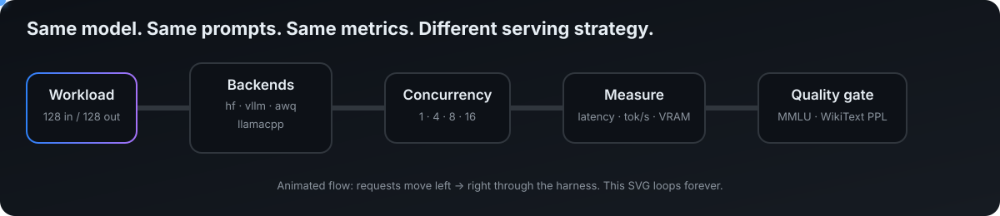
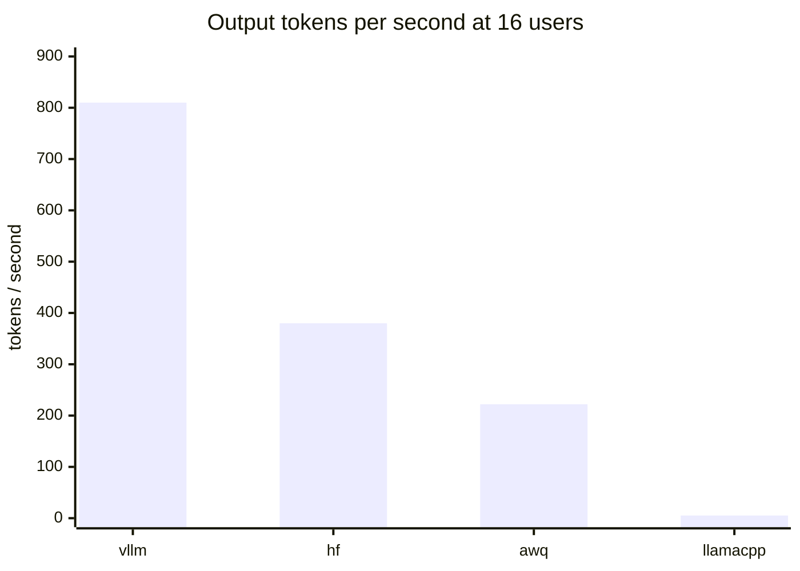
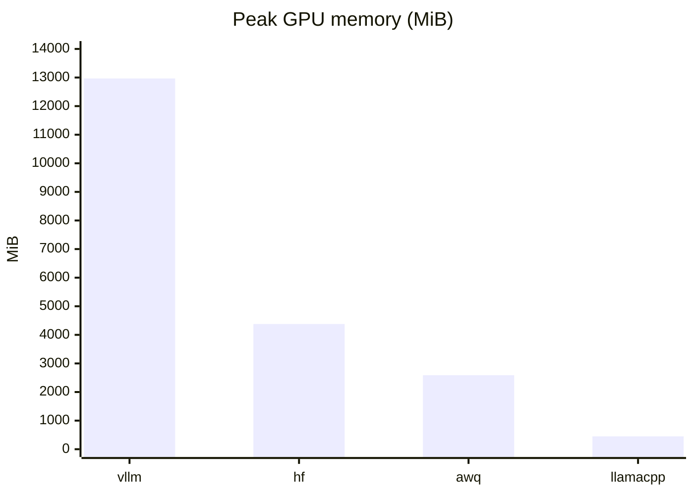
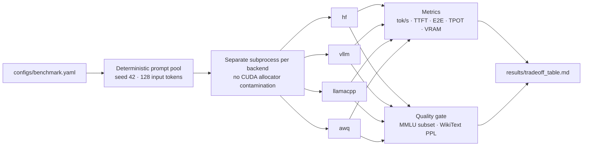

<div align="center">

# LLM Inference & Quantization Benchmark


**How fast and cheap can we run a useful small model — and what quality do we give up?**

One model. Four serving strategies. One fair workload. Real latency, throughput, VRAM, MMLU, and perplexity numbers on a Tesla T4.

[Live dashboard](https://ishan-5.github.io/LLM-inference-and-quantization-benchmark/) · [Dashboard source](docs/index.html) · [Final report](results/tradeoff_table.md) · [Summary CSV](results/summary.csv) · [Raw evidence](results/raw/) · [Colab steps](COLAB_STEPS.md) · [Local run](LOCAL_LAPTOP.md)

</div>

---

## Animated pipeline




> Both graphics are plain SVG with no JavaScript. Reload the page to replay the animation.

---

## Final result — Tesla T4 16 GB

Qwen2.5-1.5B-Instruct · concurrency 1 / 4 / 8 / 16 · greedy decoding · 128 input tokens · 128 max new tokens. MMLU is a **40-question** subset; Wilson 95% intervals are shown because the point estimates are not statistically distinguishable.

| Setup | Out tok/s @16 | Total tok/s @16 | E2E p95 ms | TTFT p95 ms | Peak GPU MiB | MMLU % (95% CI) | WikiText PPL | Speedup vs HF |
| --- | ---: | ---: | ---: | ---: | ---: | ---: | ---: | ---: |
| **vllm** | **809.97** | **1,656.85** | **2,523.64** | 115.07 | 12,968 | **57.50** (42.2–71.5) | **28.89** | **2.13×** |
| hf | 379.90 | 777.11 | 5,733.60 | **76.33** | 4,380 | 57.50 (42.2–71.5) | 28.90 | 1.00× |
| awq | 222.10 | 453.52 | 9,264.46 | 130.31 | **2,588** | 47.50 (32.9–62.5) | 30.81 | 0.58× |
| llamacpp | 5.26 | 10.00 | 365,643.37 | 345,755.96 | 450 | 55.00 (39.8–69.3) | 29.93 | 0.01× |

**Winner: `vllm`.** It delivers **2.13×** the throughput of plain Transformers at concurrency 16. It uses the same FP16 weights as HF, so identical MMLU is expected — not evidence of a quality advantage. Its 12,968 MiB peak includes preallocated KV cache, not just model weights.





---

## What this project actually tests

This is a **systems/infra** benchmark, not a model-quality leaderboard. The base model is fixed; only the serving strategy changes.

| Setup | Implementation | What it demonstrates |
| --- | --- | --- |
| `hf` | Plain `transformers` + PyTorch FP16 | Honest baseline; static batching, no KV paging |
| `vllm` | vLLM async engine FP16 | PagedAttention + continuous batching under concurrency |
| `llamacpp` | `llama-cpp-python` with Q4_K_M GGUF | Lightweight runtime, quantized kernels, small memory footprint |
| `awq` | AutoAWQ INT4 | Activation-aware weight quantization; VRAM and bandwidth tradeoff |
| `gptq` | AutoGPTQ INT4 (optional) | Alternative 4-bit family; skipped in the final run because `auto_gptq` was unavailable |

All four final backends produced **0 benchmark errors**, non-zero output tokens, and valid GPU-memory samples. Environment versions are saved in `results/raw/env_*.json`.

---

## Harness architecture



Each backend runs in its own process. Mixing vLLM, AWQ, and Transformers in one Python process causes CUDA allocator and graph conflicts, so the harness isolates them deliberately.

---

## Metrics

| Metric | Why it matters |
| --- | --- |
| Output tokens/sec | Primary serving throughput number |
| Total tokens/sec | Includes prompt processing; useful for long-input workloads |
| TTFT p50 / p95 | Time to first token; perceived responsiveness |
| E2E p50 / p95 | Full request latency; SLA-relevant tail number |
| TPOT p95 | Inter-token latency; streaming smoothness |
| Peak GPU MiB | Deployment cost and whether the model fits alongside other work |
| WikiText perplexity | Generic language-model quality regression |
| MMLU subset accuracy | Task-level quality regression, reported in percentage points |

Quality columns are reported against the `hf` baseline, but at n=40 a 2-pp gate is smaller than one question. Treat MMLU as a regression screen with intervals, not a significance test. `configs/benchmark.yaml` reproduces the published table (`mmlu_examples: 40`, `repeats: 1`); future runs should use 200+ MMLU examples and 2–3 repeats before making quality or variance claims.

---

## What I found

**1. Continuous batching is the headline win — and it is expected.** vLLM reaches 810 out tok/s at 16 users versus 380 for HF. Its advantage grows with concurrency because new requests enter as soon as a sequence finishes; HF waits for the slowest member of a static batch. This is a well-known result; the value here is that the harness measures it reproducibly.

**2. Paged KV cache keeps the tail small.** vLLM E2E p95 is 2,524 ms versus 5,734 ms for HF. PagedAttention reduces fragmentation and keeps more concurrent sequences resident.

**3. AWQ's clean win is memory, not speed.** In the same HF engine, AWQ uses 2,588 MiB versus HF's 4,380 MiB — **41% less VRAM** — while throughput is lower (222 vs 380 tok/s). The MMLU point estimate is lower (47.5% vs 57.5%), but the 95% intervals overlap heavily, so that difference is not a finding at n=40.

**4. llama.cpp is a deployment tradeoff, not a throughput winner here.** It uses just 450 MiB and scores 55.0% MMLU (95% CI 39.8–69.3), but the measured path processes concurrent requests sequentially, so its rows are repeated single-stream measurements rather than shared-server batching.

**5. HF is the control, not the punchline.** Its rising tail latency is what makes the other numbers meaningful.

## What this does not show

- **No vLLM+AWQ comparison.** AWQ ran through the HF engine; vLLM ran FP16 through vLLM. Comparing them confounds engine with quantization. Only HF vs AWQ isolates quantization.
- **No statistical quality claim.** MMLU used n=40. All 95% intervals overlap; a 10-pp gap is about four questions.
- **No p95 error bars.** There was one measured repeat per concurrency level. The published config stays at `repeats: 1` for reproducibility; future runs should use 2–3 repeats and report variance.
- **No novelty claim.** "vLLM beats plain Transformers under concurrency" is known. The contribution is the harness, the fixed workload, and the explicit uncertainty reporting.

---

## Reproduce it

### Colab T4 — recommended

```python
!bash scripts/bootstrap_colab.sh
!python -m llmbench.cli doctor
!python -m llmbench.cli all --config configs/benchmark.yaml --backends hf,vllm,llamacpp,awq --limit-prompts 8 --results-dir results_smoke
!bash scripts/run_all.sh
```

Full step-by-step checklist: [COLAB_STEPS.md](COLAB_STEPS.md). Notebook: [notebooks/01_t4_quickstart.ipynb](notebooks/01_t4_quickstart.ipynb).

### Kaggle T4

```python
!bash scripts/bootstrap_kaggle.sh
!bash scripts/run_all.sh
```

### Local Windows validation

Native Windows cannot run vLLM. For an RTX 3050 Laptop 4 GB, use the reduced 0.5B config:

```powershell
powershell -File scripts\bootstrap_windows_gpu.ps1
$env:PYTHONPATH = "$PWD\src"
.\.venv\Scripts\python.exe -m llmbench.cli doctor
.\.venv\Scripts\python.exe -m llmbench.cli all --config configs\laptop_rtx3050.yaml --backends hf,llamacpp,awq,gptq
```

The local run is in `results_laptop/tradeoff_table.md`. It is useful validation but **not** the final portfolio result: vLLM is absent, AWQ runs unfused, llama.cpp is single-stream, and the Windows GPTQ wheel lacks working CUDA kernels, so its local quality row is invalid.

---

## Commands reference

```bash
python -m llmbench.cli doctor                                  # GPU + backend check
python -m llmbench.cli prepare --backends hf,vllm,llamacpp,awq # download assets
python -m llmbench.cli benchmark --backends hf,vllm,llamacpp,awq
python -m llmbench.cli quality --backends hf,vllm,llamacpp,awq
python -m llmbench.cli all --backends hf,vllm,llamacpp,awq     # everything + report
python -m llmbench.cli report                                   # rebuild report from raw JSON
```

Useful flags:

- `--limit-prompts 8` — fast smoke test.
- `--backends hf,gptq` — include or exclude setups.
- `--config configs/benchmark.yaml` — change workload, concurrency, or quality gate.
- `--results-dir results_v2` — keep an independent run for comparison.

---

## Repo map

```text
.
├── configs/                 # final T4 config + reduced laptop config
├── docs/                    # GitHub Pages dashboard + animated SVGs
│   ├── index.html           # interactive results dashboard
│   ├── assets/              # animated SVG pipeline and result bars
│   └── data/                # dashboard copy of summary.json
├── notebooks/               # Colab quickstart
├── scripts/                 # bootstrap, full run, Windows helpers
├── src/llmbench/
│   ├── backends/            # hf, awq, gptq, vllm, llama.cpp adapters
│   ├── cli.py               # CLI + isolated backend subprocess runner
│   ├── config.py            # YAML config loader
│   ├── data.py              # deterministic prompts + MMLU/WikiText loaders
│   ├── hardware.py          # GPU/env reporting and memory sampling
│   ├── metrics.py           # latency and throughput aggregation
│   ├── report.py            # tradeoff table + recommendation generator
│   └── runner.py            # benchmark and quality orchestration
├── results/                 # FINAL T4 report, summary, raw JSON evidence
├── results_laptop/          # reduced RTX 3050 validation run
├── results_smoke/           # 8-prompt smoke run
└── results_final.zip        # downloadable copy of final results
```

---

## Fairness rules baked into the harness

- Same model family and tokenizer lineage across setups.
- Same deterministic prompt pool, seed, input length target, and max new tokens.
- Greedy decoding (`temperature=0`) for stable quality scoring.
- Warmup requests before measurement.
- GPU memory sampled during the measured window, not only after load.
- One subprocess per backend to avoid allocator contamination.
- Fixed quality subset; reported as regression detection, not a leaderboard claim.

Known approximation: llama.cpp streaming reports content chunks, so token arrival times are chunk-based. vLLM and HF/quant backends use native token IDs. This is documented in the generated caveats.

---

## Risks and mitigations

| Risk | Mitigation |
| --- | --- |
| Colab/Kaggle GPU is not actually T4 | `doctor` prints GPU name; saved in `results/raw/env_*.json` |
| llama.cpp built for CPU | Label it clearly; do not compare as GPU |
| MMLU subset too noisy | Published run used n=40; use 200+ in future runs and report Wilson intervals |
| p95 unstable | Published run used 1 repeat; set `repeats: 2` or `3` for future runs |
| AWQ OOM | Lower `gpu_memory_utilization` for vLLM; backends already run separately |
| GPTQ quality invalid on Windows | Check `raw/env_*.json` and `raw/quality_*.json` before trusting it |

---

## Final deliverables

- [Live dashboard](https://ishan-5.github.io/LLM-inference-and-quantization-benchmark/) — interactive charts and headline table ([source](docs/index.html)).
- [`results/tradeoff_table.md`](results/tradeoff_table.md) — final table, recommendation, caveats.
- [`results/summary.csv`](results/summary.csv) — numbers for charts.
- [`results/summary.json`](results/summary.json) — machine-readable winner and summaries.
- [`results/raw/*.json`](results/raw/) — benchmark, quality, and environment evidence.
- [`CLAIMS.md`](CLAIMS.md) — claim → evidence → caveat ledger.
- [`tests/`](tests/) — report/config regression checks (`python -m unittest discover -s tests -v`).
- This README — methodology, mechanisms, and why the result happened.

## Prepared v2 run — not yet executed

[`COLAB_V2_STEPS.md`](COLAB_V2_STEPS.md) and [`configs/benchmark_v2.yaml`](configs/benchmark_v2.yaml) close the remaining gaps: **n=200 MMLU**, **3 repeats**, and a **same-engine vLLM FP16 vs AWQ** comparison. It writes to `results_v2/` and will not overwrite the published table. Do not quote v2 numbers until that run exists.

Numbers come from the generated report, not from a template.


<p align="center">
  Built by <b><a href="https://github.com/Ishan-5">Devansh Kumar Pandey (Ishan)</a></b> · <a href="https://linkedin.com/in/devansh584">LinkedIn</a>
</p>
