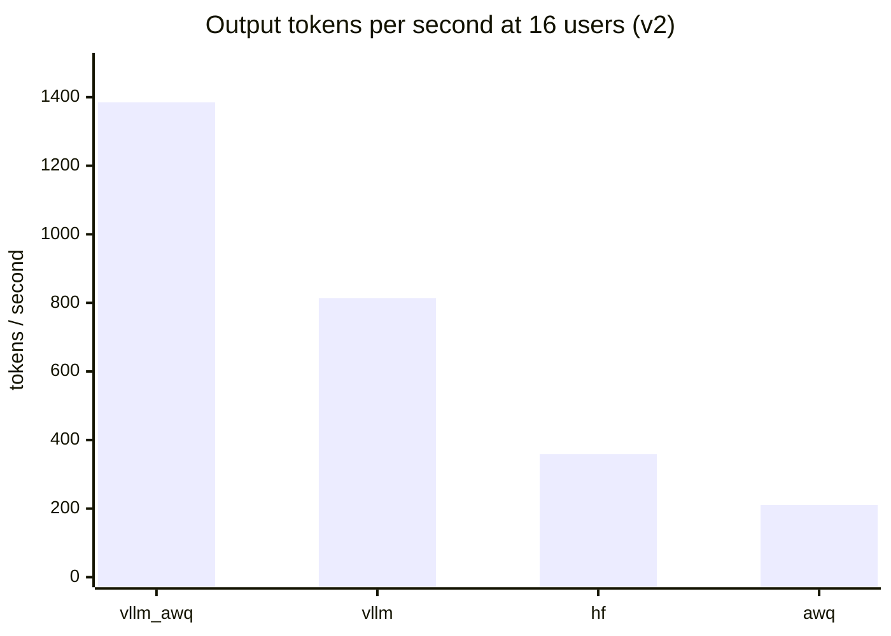
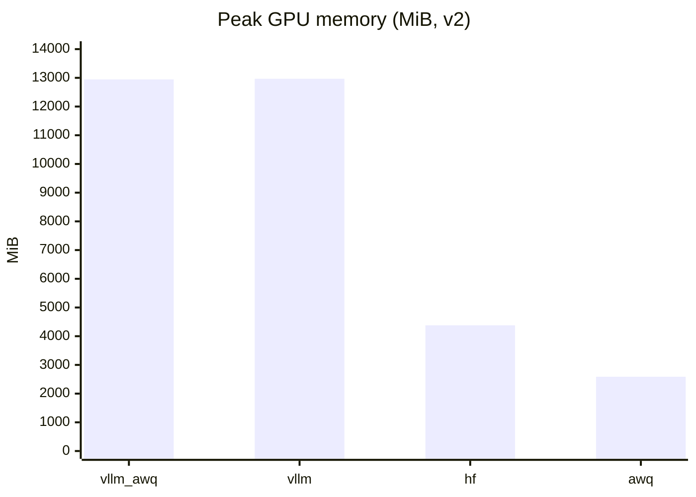
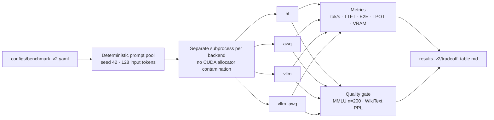

<div align="center">

# LLM Inference & Quantization Benchmark


**How fast and cheap can we run a useful small model — and what quality do we give up?**

One model. Four serving strategies. One fair workload. Real latency, throughput, VRAM, MMLU, and perplexity numbers on a Tesla T4.

[Live dashboard](https://ishan-5.github.io/LLM-inference-and-quantization-benchmark/) · [Dashboard source](docs/index.html) · [Primary v2 report](results_v2/tradeoff_table.md) · [v1 report](results/tradeoff_table.md) · [Raw v2 evidence](results_v2/raw/) · [Colab steps](COLAB_V2_STEPS.md) · [Local run](LOCAL_LAPTOP.md)

</div>

---

## Animated pipeline




> Both graphics are plain SVG with no JavaScript. Reload the page to replay the animation.

---

## Primary result — Tesla T4 16 GB (v2)

Qwen2.5-1.5B-Instruct · concurrency 1 / 4 / 8 / 16 · greedy decoding · 128 input tokens · 128 max new tokens · **3 repeats per level** · MMLU **n=200 per backend**. Wilson 95% intervals are shown; sample SD is in the generated report and dashboard whiskers.

| Setup | Out tok/s @16 ±SD | Total tok/s @16 | E2E p95 ms ±SD | TTFT p95 ms | Peak GPU MiB | MMLU % (95% CI) | WikiText PPL | Speedup vs HF |
| --- | ---: | ---: | ---: | ---: | ---: | ---: | ---: | ---: |
| **vllm_awq** | **1,384.83 ± 9.85** | **2,827.82** | **1,480.38 ± 11.14** | 109.36 | 12,946 | 51.00 (44.1–57.8) | 30.79 | **3.86×** |
| vllm | 813.53 ± 2.68 | 1,664.13 | 2,525.13 ± 13.49 | 132.65 | 12,968 | 49.50 (42.6–56.4) | **28.89** | 2.27× |
| hf | 358.73 ± 9.55 | 733.80 | 6,019.19 ± 273.82 | **73.11** | 4,380 | 49.50 (42.6–56.4) | 28.90 | 1.00× |
| awq | 210.39 ± 2.20 | 429.61 | 9,965.73 ± 101.66 | 124.05 | **2,588** | 50.50 (43.6–57.4) | 30.81 | 0.59× |

**Winner: `vllm_awq`.** It delivers **3.86×** the throughput of plain Transformers and **1.70×** the throughput of `vllm` FP16 at concurrency 16. The second comparison is same-engine, so it isolates the AWQ weight/kernel effect from serving-engine differences. MMLU intervals overlap and AWQ has slightly higher perplexity; do not claim a quality win. vLLM's ~12.9 GB peak includes preallocated KV cache, so AWQ does **not** reduce vLLM peak VRAM here.





---

## What this project actually tests

This is a **systems/infra** benchmark, not a model-quality leaderboard. The base model is fixed; only the serving strategy changes.

| Setup | Implementation | What it demonstrates |
| --- | --- | --- |
| `hf` | Plain `transformers` + PyTorch FP16 | Honest baseline; static batching, no KV paging |
| `awq` | AutoAWQ INT4 in the HF engine | Activation-aware weight quantization; VRAM and bandwidth tradeoff |
| `vllm` | vLLM async engine FP16 | PagedAttention + continuous batching under concurrency |
| `vllm_awq` | vLLM async engine with AWQ weights | Same-engine quantization comparison; kernels + continuous batching |
| `llamacpp` | `llama-cpp-python` with Q4_K_M GGUF | In v1 only: lightweight runtime, measured sequential concurrent path |
| `gptq` | AutoGPTQ INT4 (optional) | Alternative 4-bit family; excluded because Colab had no `auto_gptq` and Windows kernels were invalid |

All four v2 backends produced **0 benchmark errors**, non-zero output tokens, and valid GPU-memory samples. Environment versions are saved in `results_v2/raw/env_*.json`.

---

## Harness architecture



Each backend runs in its own process. Mixing vLLM, AWQ, and Transformers in one Python process causes CUDA allocator and graph conflicts, so the harness isolates them deliberately.

---

## Metrics

| Metric | Why it matters |
| --- | --- |
| Output tokens/sec | Primary serving throughput number |
| Total tokens/sec | Includes prompt processing; useful for long-input workloads |
| TTFT p50 / p95 | Time to first token; perceived responsiveness |
| E2E p50 / p95 | Full request latency; SLA-relevant tail number |
| TPOT p95 | Inter-token latency; streaming smoothness |
| Peak GPU MiB | Deployment cost and whether the model fits alongside other work |
| WikiText perplexity | Generic language-model quality regression |
| MMLU subset accuracy | Task-level quality regression, reported in percentage points |

Quality columns are reported against the `hf` baseline. The v2 run uses **n=200 MMLU and 3 repeats**; all Wilson 95% intervals still overlap, so point-estimate deltas are a regression screen, not significance findings. `configs/benchmark_v2.yaml` reproduces the primary table; `configs/benchmark.yaml` remains the untouched v1 reproduction (`mmlu_examples: 40`, `repeats: 1`).

---

## What I found

**1. Same-engine AWQ is the headline speed win.** `vllm_awq` reaches 1,384.8 out tok/s at 16 users versus 813.5 for `vllm` FP16 — **1.70× faster with engine held constant**. This isolates the AWQ weight/kernel effect from serving-engine differences. It is still a systems result on one T4, not a new attention algorithm.

**2. Continuous batching remains a large separate win.** `vllm` FP16 is 2.27× HF at 16 users, and E2E p95 is 2,525 ms versus 6,019 ms. PagedAttention and continuous batching keep the tail smaller; this is a well-known result measured reproducibly here.

**3. AWQ's clean VRAM win is in the HF engine.** HF-AWQ uses 2,588 MiB versus HF-FP16's 4,380 MiB — **41% less VRAM** — while HF-AWQ throughput is lower (210 vs 359 tok/s). vLLM's ~12.9 GB peak includes preallocated KV cache, so vLLM FP16 vs vLLM AWQ is a speed comparison, not a VRAM-saving comparison.

**4. Quality is close, with a small perplexity cost.** MMLU point estimates span 49.5–51.0% and all Wilson 95% intervals overlap. AWQ's WikiText PPL is ~30.8 versus ~28.9 for FP16. That is an honest tradeoff to report, not evidence of a statistically significant MMLU change.

**5. HF is the control, not the punchline.** Its rising tail latency is what makes the other numbers meaningful. The v1 llama.cpp row remains useful as a low-memory deployment tradeoff, but its measured concurrent path was sequential and it is not part of v2.

## What this does not show

- **No statistically significant MMLU difference.** v2 used n=200 and all intervals overlap. Do not claim a quality win or loss from point-estimate deltas.
- **No vLLM VRAM saving from AWQ.** Both vLLM rows peak near 12.9 GB because of KV-cache preallocation.
- **No 4-backend v2 result including llama.cpp.** v2 intentionally covers `hf`, `awq`, `vllm`, and `vllm_awq`; see the v1 report for llama.cpp.
- **No novelty claim.** "vLLM beats plain Transformers under concurrency" is known. The contribution is the harness, the fixed workload, same-engine comparisons, and explicit uncertainty reporting.

---

## Reproduce it

### Colab T4 — recommended (primary v2 result)

```python
!bash scripts/bootstrap_colab.sh
!python -m llmbench.cli doctor
!bash scripts/run_all_v2.sh
```

If the Colab GPU is unavailable for llama.cpp, use the validated four-backend command:

```python
!BACKENDS=hf,vllm,awq,vllm_awq bash scripts/run_all_v2.sh
```

Full step-by-step checklist: [COLAB_V2_STEPS.md](COLAB_V2_STEPS.md). Notebook: [notebooks/01_t4_quickstart.ipynb](notebooks/01_t4_quickstart.ipynb).

### Kaggle T4 — v1 reproduction

```python
!bash scripts/bootstrap_kaggle.sh
!bash scripts/run_all.sh
```

### Local Windows validation

Native Windows cannot run vLLM. For an RTX 3050 Laptop 4 GB, use the reduced 0.5B config:

```powershell
powershell -File scripts\bootstrap_windows_gpu.ps1
$env:PYTHONPATH = "$PWD\src"
.\.venv\Scripts\python.exe -m llmbench.cli doctor
.\.venv\Scripts\python.exe -m llmbench.cli all --config configs\laptop_rtx3050.yaml --backends hf,llamacpp,awq,gptq
```

The local run is in `results_laptop/tradeoff_table.md`. It is useful validation but **not** the final portfolio result: vLLM is absent, AWQ runs unfused, llama.cpp is single-stream, and the Windows GPTQ wheel lacks working CUDA kernels, so its local quality row is invalid.

---

## Commands reference

```bash
python -m llmbench.cli doctor                                  # GPU + backend check
python -m llmbench.cli prepare --backends hf,vllm,llamacpp,awq # download assets
python -m llmbench.cli benchmark --backends hf,vllm,llamacpp,awq
python -m llmbench.cli quality --backends hf,vllm,llamacpp,awq
python -m llmbench.cli all --backends hf,vllm,llamacpp,awq     # everything + report
python -m llmbench.cli report                                   # rebuild report from raw JSON
```

Useful flags:

- `--limit-prompts 8` — fast smoke test.
- `--backends hf,gptq` — include or exclude setups.
- `--config configs/benchmark.yaml` — change workload, concurrency, or quality gate.
- `--results-dir results_v2` — keep an independent run for comparison.

---

## Repo map

```text
.
├── configs/                 # v2 primary config + v1 and reduced laptop configs
├── docs/                    # GitHub Pages dashboard + animated SVGs
│   ├── index.html           # interactive v2 results dashboard
│   ├── assets/              # animated SVG pipeline and v2 result bars
│   └── data/                # dashboard copy of results_v2/summary.json
├── notebooks/               # Colab quickstart
├── scripts/                 # bootstrap, full run, Windows helpers
├── src/llmbench/
│   ├── backends/            # hf, awq, gptq, vllm, vllm_awq, llama.cpp adapters
│   ├── cli.py               # CLI + isolated backend subprocess runner
│   ├── config.py            # YAML config loader
│   ├── data.py              # deterministic prompts + MMLU/WikiText loaders
│   ├── hardware.py          # GPU/env reporting and memory sampling
│   ├── metrics.py           # latency and throughput aggregation
│   ├── report.py            # tradeoff table + recommendation generator
│   └── runner.py            # benchmark and quality orchestration
├── results_v2/              # PRIMARY v2 T4 report, summary, raw JSON evidence
├── results/                 # original v1 T4 report, including llama.cpp
├── results_laptop/          # reduced RTX 3050 validation run
├── results_smoke/           # 8-prompt smoke run
├── results_v2.zip           # downloadable copy of v2 results
└── results_final.zip        # downloadable copy of v1 results
```

---

## Fairness rules baked into the harness

- Same model family and tokenizer lineage across setups.
- Same deterministic prompt pool, seed, input length target, and max new tokens.
- Greedy decoding (`temperature=0`) for stable quality scoring.
- Warmup requests before measurement.
- GPU memory sampled during the measured window, not only after load.
- One subprocess per backend to avoid allocator contamination.
- Fixed quality subset; reported as regression detection, not a leaderboard claim.

Known approximation: llama.cpp streaming reports content chunks, so token arrival times are chunk-based. vLLM and HF/quant backends use native token IDs. This is documented in the generated caveats.

---

## Risks and mitigations

| Risk | Mitigation |
| --- | --- |
| Colab/Kaggle GPU is not actually T4 | `doctor` prints GPU name; saved in `results_v2/raw/env_*.json` and `results/raw/env_*.json` |
| llama.cpp built for CPU | Label it clearly; do not compare as GPU |
| MMLU subset too noisy | Primary v2 used n=200 and Wilson intervals; intervals still overlap |
| p95 unstable | Primary v2 used 3 repeats; chart whiskers show ±1 SD |
| AWQ OOM | Lower `gpu_memory_utilization` for vLLM; backends already run separately |
| GPTQ quality invalid on Windows | Check `raw/env_*.json` and `raw/quality_*.json` before trusting it |

---

## Final deliverables

- [Live dashboard](https://ishan-5.github.io/LLM-inference-and-quantization-benchmark/) — interactive v2 charts and headline table ([source](docs/index.html)).
- [`results_v2/tradeoff_table.md`](results_v2/tradeoff_table.md) — primary v2 table, recommendation, caveats.
- [`results_v2/summary.csv`](results_v2/summary.csv) — v2 numbers for charts.
- [`results_v2/summary.json`](results_v2/summary.json) — v2 machine-readable winner and summaries.
- [`results_v2/raw/*.json`](results_v2/raw/) — v2 benchmark, quality, and environment evidence.
- [`results/tradeoff_table.md`](results/tradeoff_table.md) — original v1 run, including llama.cpp.
- [`CLAIMS.md`](CLAIMS.md) — claim → evidence → caveat ledger.
- [`tests/`](tests/) — report/config regression checks (`python -m unittest discover -s tests -v`).
- This README — methodology, mechanisms, and why the result happened.

## Two published runs

The **v2 run** is the primary portfolio result: n=200 MMLU, 3 repeats, and same-engine vLLM FP16 vs AWQ. The **v1 run** remains as the reproducible `configs/benchmark.yaml` baseline with llama.cpp and the original one-repeat, n=40 workload. Both were executed on Tesla T4 with Qwen2.5-1.5B-Instruct; no local Windows numbers are used as final results.

Numbers come from generated reports, not from a template.


<p align="center">
  Built by <b><a href="https://github.com/Ishan-5">Devansh Kumar Pandey (Ishan)</a></b> · <a href="https://linkedin.com/in/devansh584">LinkedIn</a>
</p>
